# Chamba PE

**Servicios bajo demanda en tiempo real:** conecta a clientes con prestadores verificados (gasfiteros, electricistas, costureros, primeros auxilios y más) que están cerca y disponibles ahora, al estilo de un delivery.

Proyecto Integrador — Diseño y Desarrollo de Software · IV ciclo · Tecsup 2026-2

> 📱 **Maquetas de las 21 historias de usuario:** [docs/renders/historias-usuario.html](docs/renders/historias-usuario.html)
> Descarga el repositorio y abre el archivo en el navegador. Tiene filtro por sprint y un modo presentación (← → para avanzar, Esc para salir).

| 📄 Documento | Contenido |
|---|---|
| **README.md** (este archivo) | Presentación del proyecto |
| [docs/renders/historias-usuario.html](docs/renders/historias-usuario.html) | Maqueta de pantalla de cada historia de usuario con sus criterios de aceptación |
| [PLAN_EQUIPO.md](PLAN_EQUIPO.md) | Integrantes, capacidad, reglas de reparto, stack, Git y ceremonias Scrum |
| [SPRINTS.md](SPRINTS.md) | Planificación, reparto y burndown de los 4 sprints |
| [AVANCES.md](AVANCES.md) | Estado de cada tarea, bitácora, impedimentos y burndown |
| [TABLERO.md](TABLERO.md) | Tablero estilo Trello del sprint: Por hacer, En curso, En revisión y Terminado |
| [docs/](docs/) | Documentos fuente: visión del producto y Lab 07 (historias, criterios y estimaciones) |
| [docs/sprint4-reparto.md](docs/sprint4-reparto.md) | Reparto propuesto del Sprint 4 y pendientes de sprints anteriores  |
| [docs/android-reparto.md](docs/android-reparto.md) | App Android: qué falta del plan y reparto propuesto |
| [docs/PLAN_DESARROLLO_ANDROID.md](docs/PLAN_DESARROLLO_ANDROID.md) | Plan de la app Android (propuesta de Luis, pendiente de aprobación) |
| [app-movil/README.md](app-movil/README.md) | App Android: qué hace, cómo compilarla y cómo conectarla al backend y a Firebase |
| [backend/spring/README.md](backend/spring/README.md) | Backend de usuario con Spring Boot: alcance y cómo se conecta a la base compartida |
| [docs/API_AUTENTICACION.md](docs/API_AUTENTICACION.md) | Autenticación con roles (HU-5): rutas, sesión y CSRF, roles, permisos y token de Firebase para la app móvil |
| [docs/API_BUSQUEDA.md](docs/API_BUSQUEDA.md) | Búsqueda de prestadores (HU-3 y HU-7): parámetros, respuesta y ejemplos |
| [docs/API_VERIFICACION_DNI.md](docs/API_VERIFICACION_DNI.md) | Escaneo y validación del DNI (HU-19): MRZ, validador intercambiable y revisión manual |
| [docs/API_CONSENTIMIENTO.md](docs/API_CONSENTIMIENTO.md) | Consentimiento DNI versionado: aceptación, revocación y bloqueo de captura. |
| [docs/API_ELIMINACION_DNI.md](docs/API_ELIMINACION_DNI.md) | Eliminación DNI: estados, reintentos, procesador y límites; pendiente de revisión. |
| [docs/API_CALIFICACIONES.md](docs/API_CALIFICACIONES.md) | Calificación del servicio (HU-12): reglas, endpoints, promedio del prestador y cómo probarla |
| [docs/API_SEGUIMIENTO.md](docs/API_SEGUIMIENTO.md) | Seguimiento del servicio (HU-11): estados, orden, endpoint para avanzar y cómo probarlo |
| [docs/HU8_NOTIFICACIONES.md](docs/HU8_NOTIFICACIONES.md) | Notificaciones push (HU-8): configuración de FCM y guion de la validación T8.3 |
| [docs/GUIA_NAVEGACION.md](docs/GUIA_NAVEGACION.md) | Cómo comprobar en el navegador cada tarea terminada |
| [docs/EXPOSICION_HU19.md](docs/EXPOSICION_HU19.md) · [docs/exposicion-renzo-sprint1-2.md](docs/exposicion-renzo-sprint1-2.md) | Guías de exposición y pruebas en vivo |
| [docs/sprint2-review.md](docs/sprint2-review.md) | Cierre del Sprint 2: estado por tarea, guion de la demo y propuesta de retrospectiva |
| [docs/API_RECOMENDACION.md](docs/API_RECOMENDACION.md) · [docs/API_VERIFICACION_FACIAL.md](docs/API_VERIFICACION_FACIAL.md) | Recomendación con IA (HU-10) y reconocimiento facial (HU-20) |
| [docs/graficos/](docs/graficos/) | Gráficos del README (SVG con modo oscuro) y el script que los genera |

---

## Estado del proyecto

**Al 26/11/2026 · Sprint 4 cerrado (12/11 – 25/11).** Las 16 historias comprometidas en los 4 sprints están en `main`; quedan validaciones puntuales. El detalle diario está en [AVANCES.md](AVANCES.md).

<p align="center">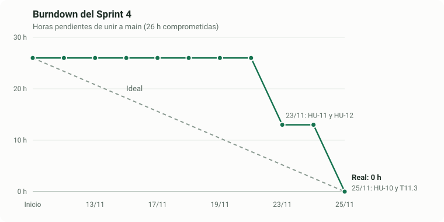</p>

| Sprint | Resultado |
|:---:|---|
| 1 | ✅ Cerrado: HU-1 a HU-4 completas (26 de 30 h en el sprint; el resto se unió el 18/10) |
| 2 | ✅ Cerrado: HU-5, HU-6 y HU-9 completas (15 de 23 h); HU-7 se unió el 04/11 |
| 3 | ✅ HU-19, HU-21 y HU-8 en `main`; HU-13 y HU-20, que se habían postergado, se unieron el 26/11 (#56 y #59) |
| 4 | ✅ Cerrado: HU-10 (#53, #55), HU-11 (#44, #49) y HU-12 (#42), 26 de 26 h |

| Historia | Estado |
|---|---|
| HU-1 Registro del prestador · HU-2 Certificaciones · HU-3 Búsqueda · HU-4 Solicitud | ✅ En `main` |
| HU-5 Cuentas y roles · HU-6 Disponibilidad · HU-7 Mapa · HU-9 Revisión por el administrador | ✅ En `main` |
| HU-10 Recomendación con IA · HU-11 Seguimiento · HU-12 Calificación | ✅ En `main` ([recomendación](docs/API_RECOMENDACION.md), [seguimiento](docs/API_SEGUIMIENTO.md), [calificación](docs/API_CALIFICACIONES.md)) |
| HU-13 Suspensión y bloqueo · HU-21 Consentimiento y eliminación de datos | ✅ En `main` |
| HU-20 Reconocimiento facial | 🟡 En `main` (OpenCV SFace); falta calibrar el umbral con fotos del equipo (T20.4) |
| HU-19 Escaneo del DNI | 🟡 En `main` con sus pruebas (T19.4); con OCR real muchas fotos pasan a revisión manual ([impedimento 24](AVANCES.md)) |
| HU-8 Notificaciones push | 🟡 En `main`; falta medir la entrega real en menos de 5 s (T8.3) |
| App Android | 🟡 Búsqueda con Google Maps, registro por pasos, y solicitudes y perfil en la API de Django (lo mismo que ve la web): Firebase queda solo para la identidad (proyecto del equipo `chamba-pe-c043f`). Falta recorrer el alta con una cuenta real y probar en teléfono físico ([pendientes](docs/android-reparto.md)) |

<p align="center">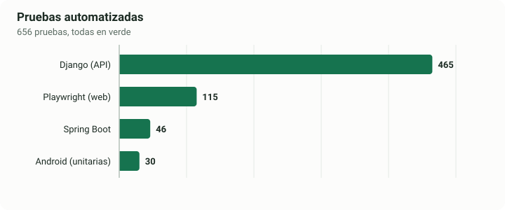</p>

> Pagos, chatbot clasificador, rubros con comisiones y métricas del administrador siguen fuera del alcance (backlog futuro).

---

## Cómo se ve

**Web** — una sola aplicación con pantallas separadas por rol (cliente, prestador y administración).

| Portada | Cliente: Mis servicios |
|:---:|:---:|
| 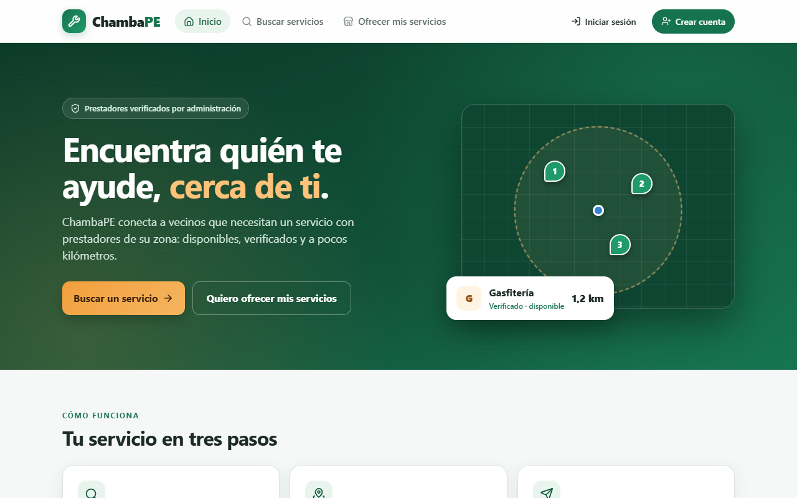 | 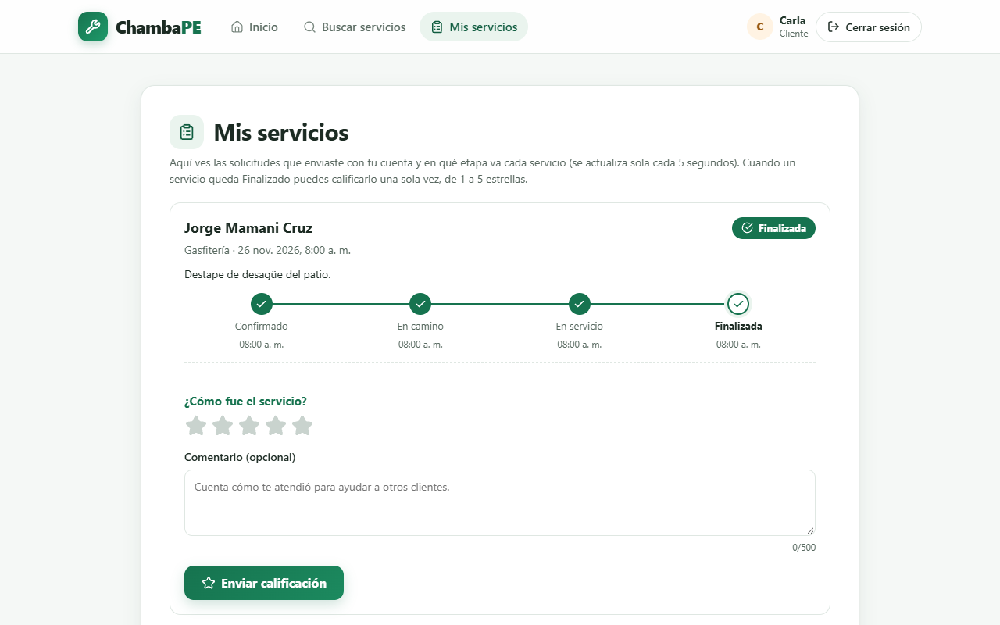 |
| **Prestador: solicitudes recibidas** | **Administración: panel** |
| 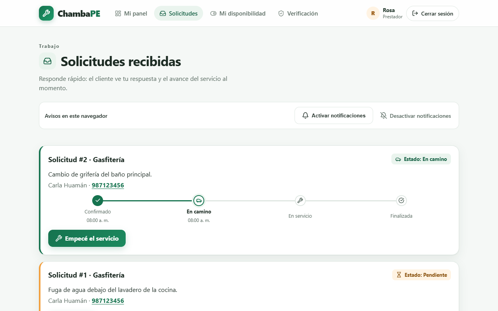 | 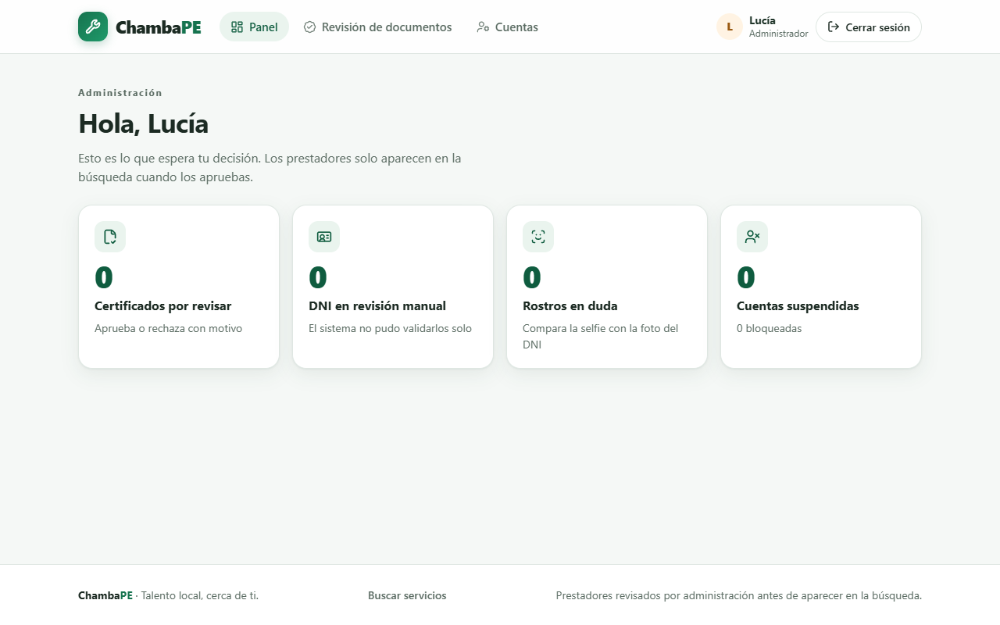 |

**App Android** — registro por pasos, una pregunta por pantalla.

| Ingreso | Servicios (paso 3 de 5) | Zona con Google Maps | Revisión antes de enviar |
|:---:|:---:|:---:|:---:|
| 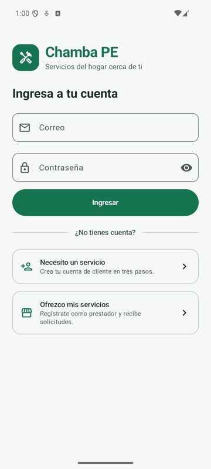 | 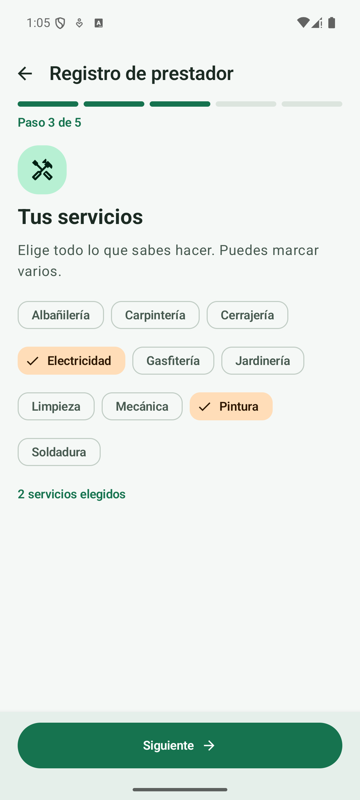 | 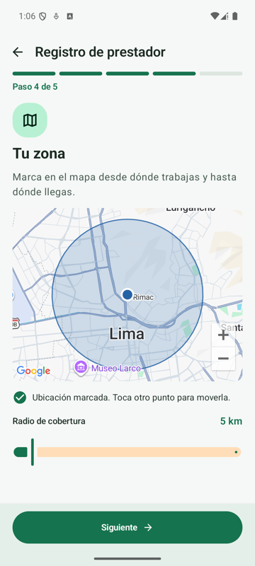 | 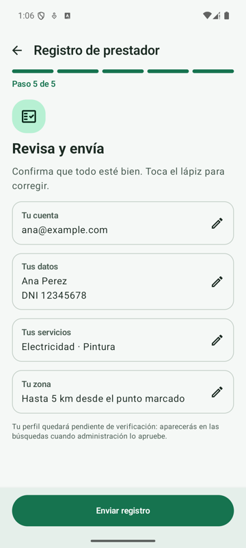 |

### Diseño y movimiento

- **Una marca en web y app:** verde `#16734F` y acento naranja `#F29F3D`. En la app, un tema Material 3 claro y oscuro (`app-movil/.../ui/Tema.kt`). En la web, los tokens de `web-portal/src/estilos/Tema.css`.
- **Iconos de una sola familia:** [lucide](https://lucide.dev) en la web (`src/nucleo/iconos.js`, un icono por ruta, por rubro y por estado) y Material Symbols en la app. No se usan caracteres como ★ o ✓ como iconos.
- **Movimiento con propósito** (revisado con la guía de Emil Kowalski, `web-portal/src/estilos/Movimiento.css`):
  - Respuesta inmediata al presionar y avisos que se pueden interrumpir.
  - Listas que entran escalonadas y un solo momento animado en la portada.
  - Duraciones bajo 300 ms y curvas propias.
  - El hover solo mueve elementos con mouse.
  - Con «reducir movimiento» se quitan los desplazamientos y se mantienen los cambios de color.
- **Formularios por pasos en la app:**
  - Progreso visible y foco automático en cada paso.
  - El botón Atrás del sistema retrocede un paso sin perder datos.
  - Los errores del servidor llevan al paso donde se corrigen.

---

## ¿Qué problema resuelve?

En el día a día surgen imprevistos que necesitan solución inmediata pero no justifican una búsqueda larga ni un agendamiento formal. Llamar, buscar en redes o pedir referencias es lento y no garantiza disponibilidad.

Chamba PE conecta a quien tiene el problema con quien puede resolverlo, **al instante y cerca**: el cliente localiza, contrata y recibe al prestador en el menor tiempo posible.

## Casos de uso

| Situación | Solución con Chamba PE |
|---|---|
| 👗 Un vestido se descose horas antes de un evento | Un costurero cercano llega con sus herramientas y lo arregla en el acto |
| 🩹 Un niño se raspa la rodilla en casa | Un técnico en primeros auxilios certificado llega con su botiquín |
| 🚰 Se rompe una tubería en la oficina | Un gasfitero disponible en la zona va directo al lugar |
| ⚡ Un corto circuito deja sin luz el departamento | Un electricista verificado está en camino en minutos |

## Funcionalidades principales

- Solicitud de servicio en tiempo real, sin agendamiento previo
- Geolocalización y mapa de prestadores dentro del radio de cobertura
- Perfiles verificados (DNI y certificaciones) con calificaciones y reseñas
- Seguimiento del servicio: Confirmado → En camino → En servicio → Finalizado
- Notificaciones push al prestador
- Historial de servicios y módulo de pagos
- Panel de administración: revisión manual de prestadores, suspensión y bloqueo de cuentas (rubros, comisiones y métricas en una fase posterior)

## Seguridad: verificación del prestador

La confianza es lo más importante: el cliente deja entrar a un desconocido a su casa u oficina. Por eso todo prestador pasa por una verificación de identidad antes de poder trabajar:

1. **Acepta el uso de sus datos biométricos** (Ley 29733 de Protección de Datos Personales).
2. **Escanea su DNI** → la app lee el número y los nombres automáticamente.
3. **Se valida el DNI** consultando la fuente pública eldni.com.
4. **Se toma una selfie en vivo** con prueba de vida (parpadeo).
5. **Reconocimiento facial:** se compara la selfie con la foto del DNI.
6. Si todo coincide, obtiene la insignia **"Identidad verificada"**; si hay dudas, lo revisa un administrador.

## Inteligencia Artificial

- **Reconocimiento facial:** confirma que el prestador es el titular del DNI.
- **Recomendación:** sugiere al prestador más adecuado según distancia, calificación, disponibilidad y tipo de servicio.
- **Tiempo estimado de llegada:** la recomendación indica cuánto tardará el prestador.
- **Chatbot clasificador** _(fase posterior)_: el cliente describe su problema en texto libre y la IA lo asigna al oficio correcto.

## Público objetivo

- **Clientes:** personas, familias, oficinas, hoteles y negocios que necesitan resolver algo puntual y rápido.
- **Prestadores:** trabajadores independientes, técnicos certificados y pequeñas empresas de servicios que buscan ingresos diarios con clientes cercanos.

## Categorías del MVP

Costura · Primeros auxilios · Gasfitería · Electricidad · Limpieza de emergencia · Mudanza y carga liviana · Reparaciones del hogar

---

## Product Backlog

**21 historias de usuario · 62 story points.** 16 historias (51 SP) están comprometidas en 4 sprints; las otras 5 (11 SP) quedan en el backlog futuro. Ver cada pantalla en las [maquetas](docs/renders/historias-usuario.html) y el detalle en [docs/Lab07_CPS_ChambaYa.md](docs/Lab07_CPS_ChambaYa.md).

| Sprint | Fechas | Historias | SP | Meta |
|:---:|:---:|---|:---:|---|
| 1 | 01/10 – 14/10/2026 | HU-1 Registro del prestador · HU-2 Certificaciones · HU-3 Búsqueda · HU-4 Solicitud y aceptación | 13 | MVP: el prestador se registra y el cliente lo encuentra y le envía una solicitud |
| 2 | 15/10 – 28/10/2026 | HU-5 Registro e inicio de sesión · HU-6 Disponibilidad · HU-7 Mapa · HU-8 Notificaciones · HU-9 Validación por el administrador | 13 | Cuentas, disponibilidad, mapa, notificaciones y verificación de prestadores |
| 3 | 29/10 – 11/11/2026 | HU-19 Escaneo del DNI · HU-20 Selfie y reconocimiento facial · HU-21 Consentimiento biométrico · HU-13 Suspensión y bloqueo | 13 | Verificación de identidad del prestador y moderación |
| 4 | 12/11 – 25/11/2026 | HU-10 Recomendación con IA · HU-11 Seguimiento en tiempo real · HU-12 Calificación | 12 | Recomendación con IA, seguimiento en tiempo real y calificación |
| Futuro | — | HU-14 Alternativos · HU-15 Chatbot · HU-16 Rubros y comisiones · HU-17 Parámetros del matching · HU-18 Métricas | 11 | Se planifican cuando haya capacidad |

Capacidad: 30 h por sprint (3 integrantes × 10 h) · 114 h planificadas. Detalle de tareas en [SPRINTS.md](SPRINTS.md) y avance diario en [AVANCES.md](AVANCES.md).

---

## Arquitectura

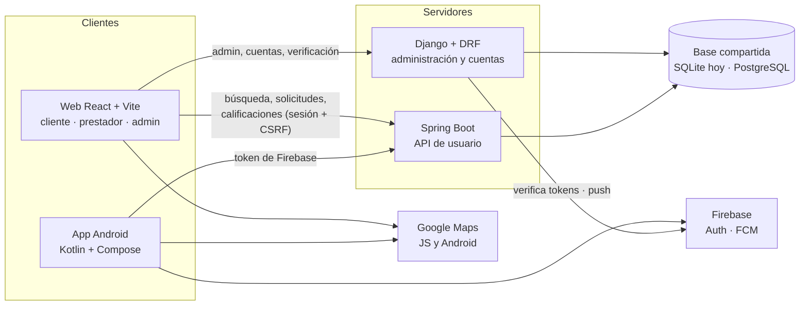

| Módulo | Front end | Back end | Carpeta |
|---|---|---|---|
| **Administración** | Web React | Django | `web-portal/` · `backend/django/` |
| **Usuario** (cliente y prestador) | Móvil Kotlin y web React | Spring Boot: la app usa solo Spring; la web usa Spring para búsqueda, recomendación con IA, solicitudes, seguimiento, disponibilidad y calificaciones (con la misma sesión de Django) y Django para su cuenta y la verificación de identidad | `app-movil/` · `web-portal/` · `backend/spring/` |
| **Base de datos** | — | Compartida (hoy SQLite local; PostgreSQL previsto): Django es dueño de las tablas y migraciones | configuración por variables de entorno |

| Capa | Tecnología |
|---|---|
| Backend principal | Django + Django REST Framework (`backend/django/`) |
| Backend de usuario | Spring Boot 4.1 + Java 21 (`backend/spring/`): búsqueda, recomendación con IA (HU-10), solicitudes, seguimiento, disponibilidad, registro desde la app y calificaciones, con respuestas idénticas a Django |
| Frontend web | React 19 + Vite, iconos lucide, mapas con Google Maps y respaldo en OpenStreetMap |
| App móvil | Android nativo: Kotlin, Jetpack Compose (Material 3) y MVVM, con Retrofit, Room, Firebase Auth y maps-compose |
| Tiempo real | Consulta automática cada 5 s (HU-11); WebSocket queda como mejora posterior |
| Notificaciones | Firebase Cloud Messaging (web, con service worker) |
| Verificación de identidad | Lectura de la MRZ del DNI (EasyOCR), selfie con prueba de vida (MediaPipe) y comparación facial (OpenCV SFace), con revisión manual cuando hay dudas |
| IA | Recomendación del prestador por puntaje de distancia, calificación y disponibilidad (HU-10) |

### Flujo de una solicitud (HU-4, HU-11 y HU-12)

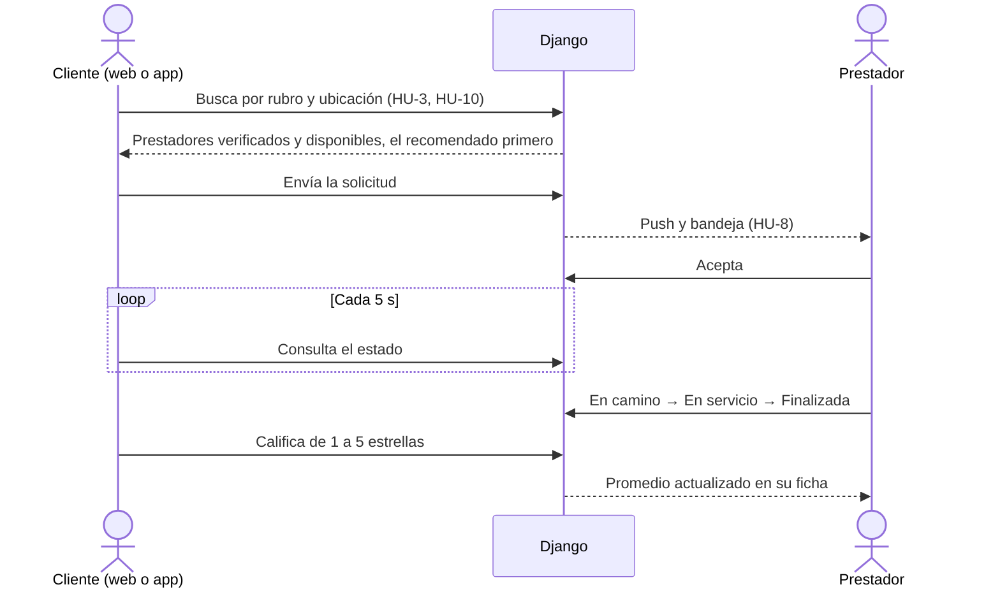

### Recorrido por rol

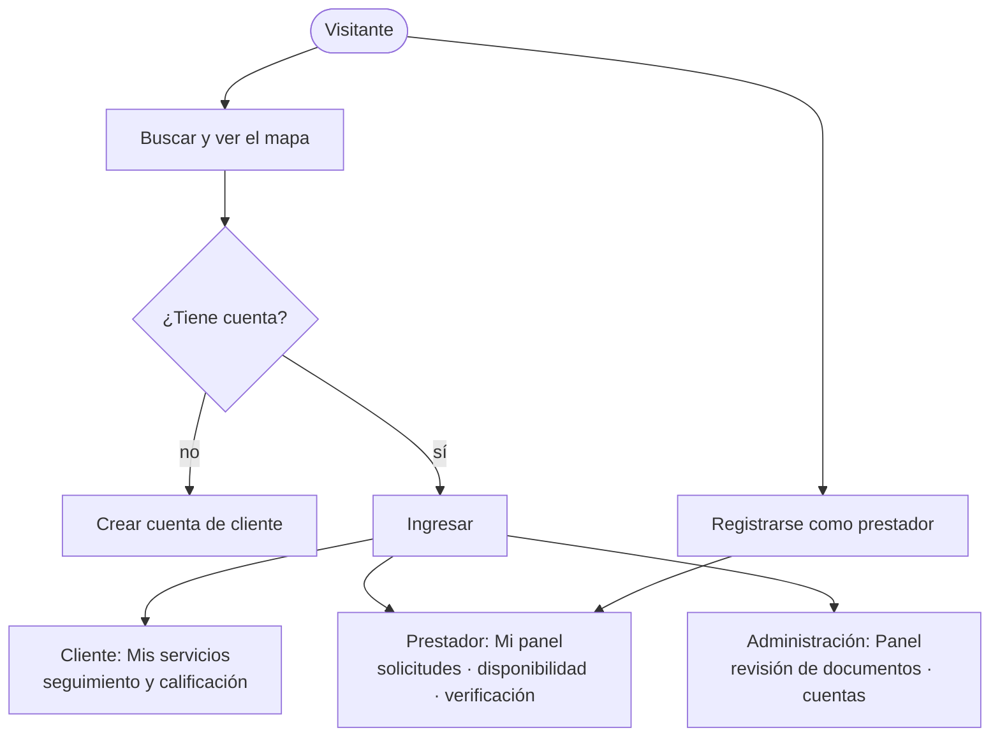

## Estructura del repositorio

```
Chamba-PE/
├── app-movil/              App Android (Kotlin + Compose)                   → Front End Móvil
├── web-portal/             Web React + Vite: portada, cuentas, búsqueda con mapa, solicitudes,
│                           disponibilidad, certificados, verificación del DNI y panel de revisión
│                                                                            → Front End Web
├── backend/
│   ├── django/             Back End de administración (y API actual)        → Back End Django
│   │   ├── core/               Configuración de Django (settings, urls)
│   │   ├── prestadores/        Prestador, rubros, cobertura, registro y búsqueda (HU-1, HU-3)
│   │   ├── servicios/          Solicitudes y notificaciones push (HU-4, HU-7, HU-8)
│   │   ├── usuarios/           Cuentas, inicio de sesión, roles y disponibilidad (HU-5, HU-6)
│   │   ├── certificaciones/    Carga de certificaciones PDF/JPG ≤ 5 MB (HU-2)
│   │   ├── administracion/     Revisión de documentos por el administrador (HU-9)
│   │   ├── verificacion/       Escaneo del DNI, consentimiento y eliminación de datos (HU-19, HU-21)
│   │   ├── calificaciones/     Calificación del servicio y promedio del prestador (HU-12)
│   │   ├── tools/              Scripts de apoyo a las pruebas
│   │   ├── manage.py
│   │   └── requirements.txt    Dependencias de Python
│   └── spring/             Back End de usuario                              → Back End Spring Boot
├── docs/                   Contratos de API, guías, evidencias, Lab 07 y maquetas (docs/renders/)
├── .github/CODEOWNERS      Revisor automático de cada carpeta
└── AVANCES.md · SPRINTS.md · TABLERO.md · PLAN_EQUIPO.md · README.md
```

**Estructura desde el 17/11/2026.** Los registros anteriores (AVANCES, informes de pruebas y guías de sprints pasados) conservan las rutas de entonces:

| Ruta anterior | Ruta actual |
|---|---|
| `core/`, `prestadores/`, `servicios/`, `usuarios/`, `certificaciones/`, `administracion/`, `verificacion/`, `tools/`, `manage.py`, `requirements.txt`, `.env.example` | `backend/django/...` |
| `frontend/` | `web-portal/` |
| `mobile/android/` | `app-movil/` |
| `evidencia_rendimiento.txt` | `docs/evidencia_rendimiento.txt` |
| `src/`, `public/`, `index.html`, `package.json`, `vite.config.js` (React inicial de la raíz) | Eliminados: la web vigente es `web-portal/` |

## Cómo ejecutarlo

**Backend (Django)** — requiere Python 3.10 o superior. El entorno virtual se crea en la raíz del repositorio y los comandos de Django se ejecutan dentro de `backend/django/`:

```bash
python -m venv venv
```

```bash
venv\Scripts\activate
```

```bash
cd backend/django
```

```bash
pip install -r requirements.txt
```

```bash
python manage.py migrate
```

Para desarrollar, activar el modo debug en la misma terminal (PowerShell). Sin esto Django arranca con DEBUG apagado: no sirve `/media/` ni el CSS del panel y avisa que falta `DJANGO_SECRET_KEY`. Las variables de seguridad están en `backend/django/.env.example`.

```powershell
$env:DJANGO_DEBUG="true"
```

```bash
python manage.py runserver
```

La API queda en `http://127.0.0.1:8000/` y el panel de Django en `/admin/`.

| Endpoint | Uso |
|---|---|
| `POST /api/prestadores/registro/` | Registro del prestador (HU-1) |
| `POST /api/prestadores/registro-movil/` | Registro del prestador desde la app Android, con el token de Firebase |
| `GET /api/prestadores/rubros/` | Lista de rubros |
| `GET /api/prestadores/buscar/` | Búsqueda por rubro, disponibilidad y cobertura (T3.1); [parámetros y ejemplos](docs/API_BUSQUEDA.md) |
| `POST /api/servicios/solicitudes/` | El cliente envía una solicitud al prestador; queda Pendiente (HU-4) |
| `GET /api/servicios/solicitudes/<id>/` | El cliente consulta el estado de su solicitud (HU-4) |
| `GET /api/servicios/solicitudes/recibidas/` | Bandeja del prestador; requiere sesión con rol prestador (HU-4) |
| `POST /api/servicios/solicitudes/<id>/aceptar/` · `.../rechazar/` | El prestador responde, una sola vez (HU-4) |
| `POST /api/servicios/notificaciones/token/` | Registra el token de FCM del navegador del prestador (HU-8); [guía](docs/HU8_NOTIFICACIONES.md) |
| `POST /api/certificaciones/upload/` | Carga de certificaciones; requiere sesión del prestador (HU-2) |
| `/api/administracion/revisiones/` | El administrador lista, aprueba o rechaza documentos (HU-9) |
| `POST` · `GET /api/verificacion/dni/` | El prestador envía las fotos de su DNI y consulta el resultado (HU-19); [contrato](docs/API_VERIFICACION_DNI.md) |
| `GET` · `POST /api/verificacion/consentimiento/` · `POST .../consentimiento/revocar/` | El prestador consulta, acepta o revoca su consentimiento; sin él no se captura el DNI (HU-21); [contrato](docs/API_CONSENTIMIENTO.md) |
| `GET` · `POST /api/verificacion/eliminaciones/` · `.../<uuid>/` · `.../<uuid>/reintentar/` | El prestador solicita, consulta y reintenta la eliminación de sus datos del DNI (HU-21); [contrato](docs/API_ELIMINACION_DNI.md) |
| `POST /api/servicios/solicitudes/<id>/avanzar/` | El prestador asignado avanza el servicio: Confirmado → En camino → En servicio → Finalizada (HU-11); [contrato](docs/API_SEGUIMIENTO.md) |
| `POST /api/calificaciones/` · `GET .../mis-servicios/` | El cliente califica su servicio Finalizado y ve sus solicitudes (HU-12); [contrato](docs/API_CALIFICACIONES.md) |
| `GET /api/usuarios/csrf/` | Deja la cookie `csrftoken` para los `POST` desde React (HU-5) |
| `POST /api/usuarios/registro/` | Registro del cliente; queda con la sesión iniciada (HU-5) |
| `POST /api/usuarios/login/` · `.../logout/` | Inicio de sesión con usuario o correo, y cierre de sesión (HU-5) |
| `GET` · `PATCH /api/usuarios/disponibilidad/` | El prestador consulta o cambia su disponibilidad, Activo o Inactivo (HU-6) |
| `GET /api/usuarios/yo/` | Quién tiene la sesión y con qué rol; 403 sin sesión (HU-5); [contrato completo](docs/API_AUTENTICACION.md) |
| `POST /api/usuarios/registro-movil/` | La app crea (sin duplicar) la cuenta de cliente vinculada a su usuario de Firebase; requiere el token |
| `GET /api/ia/recomendacion/` | Prestador recomendado con motivo y tiempo estimado (HU-10); [contrato](docs/API_RECOMENDACION.md) |
| `POST` · `GET /api/verificacion/facial/` · `.../facial/consentimiento/` | Selfie con prueba de vida y comparación con el DNI (HU-20); [contrato](docs/API_VERIFICACION_FACIAL.md) |
| `GET /api/administracion/cuentas/` · `.../<id>/sancionar/` · `.../<id>/reactivar/` | El administrador suspende, bloquea o reactiva cuentas (HU-13) |

Pruebas del backend:

```bash
python manage.py test
```

**Frontend (React + Vite)** — requiere Node.js 20 o superior. Dentro de `web-portal/`, con Django (8000) **y** Spring (8080, arrancado con `DJANGO_DEBUG=true`) corriendo: Vite manda la búsqueda, la recomendación, las solicitudes, la disponibilidad y las calificaciones a Spring y el resto a Django. Sin Spring: `$env:CHAMBA_API_USUARIO="http://127.0.0.1:8000"` antes de `npm run dev`.

```bash
npm install
```

```bash
npm run dev
```

La web queda en `http://localhost:5173/`. Para comprobar cada función paso a paso, sigue la [guía de navegación](docs/GUIA_NAVEGACION.md).

**App Android** — requiere JDK 17 o superior y el SDK de Android. Dentro de `app-movil/`:

```bash
./gradlew assembleDebug
```

Necesita `google-services.json` (no está en el repositorio), la clave de Google Maps en `app-movil/local.properties` (`MAPS_API_KEY=...`, tampoco se versiona) y el backend corriendo; los pasos completos están en [app-movil/README.md](app-movil/README.md).

**Clave de Google Maps en la web:** `web-portal/.env.local` con `VITE_GOOGLE_MAPS_API_KEY=...` (no se versiona) y la «Maps JavaScript API» habilitada en Google Cloud; sin clave, la web usa OpenStreetMap.

**Backend de usuario (Spring Boot)** — lo usan la app Android y la parte de usuario de la web. Con Java 21, en otra terminal: `cd backend/spring`, `$env:DJANGO_DEBUG="true"` y `.\mvnw spring-boot:run` (puerto 8080, misma base que Django). Detalles en [backend/spring/README.md](backend/spring/README.md).

### Para tener en cuenta

- **Solo aparecen en la búsqueda los prestadores Verificados y Activos:** después de registrarse, el prestador sube un certificado, un administrador lo aprueba en `/administracion/revisiones` y el prestador activa su disponibilidad.
- **El OCR del DNI necesita EasyOCR**, que es pesado y descarga modelos la primera vez. Las pruebas automáticas no lo usan (trabajan con un lector simulado).
- **Las notificaciones push necesitan credenciales de Firebase** en variables de entorno; `.env.example` muestra cuáles. Sin ellas, el resto de la aplicación funciona igual.
- Si ya tenías el entorno creado, vuelve a correr `pip install -r requirements.txt`: se agregaron librerías en los Sprints 2 y 3.

## Flujo de trabajo

Una rama por historia (`hu-1-registro-prestador`), commits que nombran la tarea (`T1.2 API de registro de prestadores`) y Pull Request hacia `main` revisado por quien hace las pruebas de esa historia. Al terminar cada tarea se actualiza [AVANCES.md](AVANCES.md). Reglas completas en [PLAN_EQUIPO.md](PLAN_EQUIPO.md).

## Entregables

| Entregable | Semana |
|---|:---:|
| Monografía — entrega final | 14 |
| Aplicación del proyecto integrador | 16 |
| Exposición del proyecto | 16 |

## Equipo

| Integrante | GitHub | Rol |
|---|---|---|
| Renzo León | [@RXDG2908](https://github.com/RXDG2908) | Scrum Master / Desarrollador |
| Luis Abad | [@Itssmann](https://github.com/Itssmann) | Development Team |
| David Valcarcel | [@Davish-pxl](https://github.com/Davish-pxl) | Product Owner / Desarrollador |

Organización completa en [PLAN_EQUIPO.md](PLAN_EQUIPO.md).
