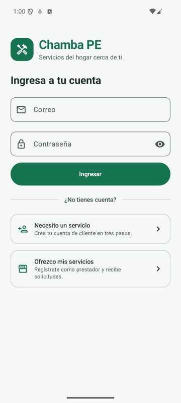
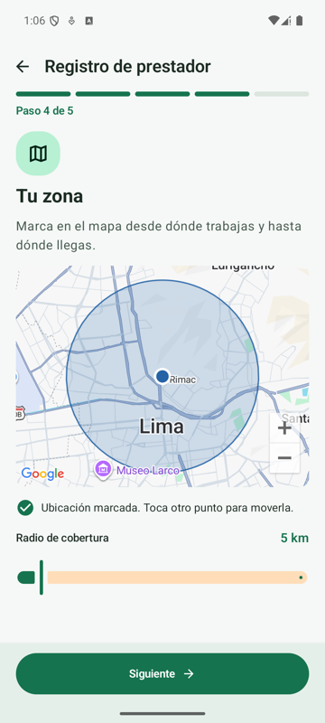
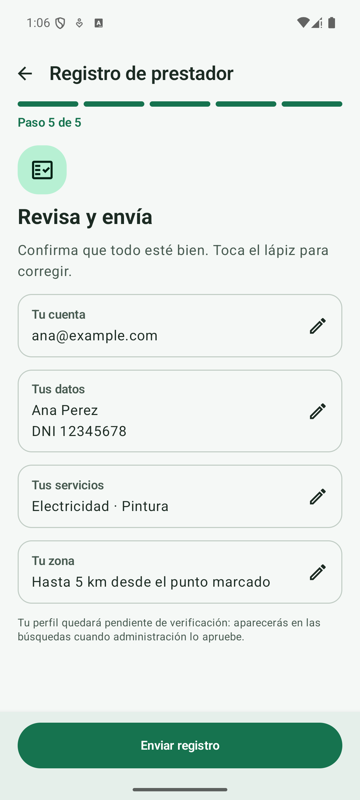

# Chamba PE — Android

App Android de Chamba PE para clientes y prestadores. Kotlin, Jetpack Compose y Material 3,
con un único módulo `app` y arquitectura MVVM.

> **Estado (26/11/2026):**
> - Compila y pasa 30 pruebas unitarias.
> - Los registros de cliente y de prestador se recorrieron paso a paso en un emulador (API 36) contra Django local, incluidos los errores de cada paso, el mapa, la revisión y el botón Atrás.
> - Las solicitudes ya van a la API de Django, las mismas que ve la web.
>
> **Falta:**
> - Probar el alta y el ingreso con el `google-services.json` real del proyecto (con uno de prueba, Firebase responde «Ocurrió un error»).
> - Probar en un teléfono físico.

<p align="center">
  
  
  
  
</p>

## Qué hace

| Función | Cómo | Tema del curso de Móviles |
|---|---|---|
| Ingreso y registro de clientes en 3 pasos (nombre, correo, contraseña) | Firebase Authentication (correo y contraseña) | Semana 11 |
| Registro de prestador en 5 pasos: cuenta, datos, servicios, zona en el mapa (centro y radio) y revisión con «editar» | Firebase Auth + `POST /api/prestadores/registro-movil/` con el token; si Django lo rechaza, la cuenta se deshace y la app vuelve al paso del error | Semanas 9 y 11 |
| Roles cliente / prestador | Perfil en Firestore `usuarios/{uid}`; el rol decide las pestañas | Semana 11 |
| Rubros y búsqueda de prestadores | Retrofit contra la API Django (`/api/prestadores/rubros/` y `/buscar/`) | Semanas 9 y 10 |
| Datos guardados y modo sin conexión | Room: última búsqueda por rubro y rubros | Semana 8 |
| Favoritos | Room; se conservan al cerrar la app y al volver a buscar | Semana 8 |
| Mapa interactivo: tocar para elegir la ubicación, marcadores numerados con ficha y calificación, círculo de cobertura | Google Maps con `maps-compose` (como el lab CampusGPS); clave en `local.properties` | Semanas 11 y 12 |
| «Usar mi ubicación» | Permiso de ubicación aproximada + Fused Location | Semana 11 |
| Enviar solicitud, seguir sus etapas (HU-11) y calificar (HU-12) | API Django `servicios` y `calificaciones` con el token; consulta cada 5 s, como la web | Semanas 9 y 11 |
| Bandeja del prestador: aceptar, rechazar, avanzar y llamar al cliente | API Django (la misma bandeja que la web) | Semanas 9 y 11 |
| Mi disponibilidad (Activo / Inactivo) del prestador | Retrofit a `/api/usuarios/disponibilidad/` con el token de Firebase; la búsqueda la refleja al instante | Semanas 9 y 11 |
| Aviso «Solicitud enviada» | Notificación local con canal y permiso `POST_NOTIFICATIONS` | Semana 12 |
| Navegación y pestañas por rol | Navigation Compose + `NavigationBar` | Semanas 5 y 6 |

**No incluye todavía:** notificaciones push con FCM, certificados ni verificación de DNI desde la app.

**Diseño:**
- Tema Material 3 claro y oscuro con los colores de la web (`ui/Tema.kt`) e iconos Material.
- Asistente por pasos reutilizable (`ui/Asistente.kt`): progreso animado, transición de eje X y Back del sistema paso a paso.
- Microanimaciones breves con curvas de Material: presión de botones, favorito que late, línea de tiempo del servicio y listas con `animateItem`.

## Estructura

```text
app/src/main/java/pe/tecsup/chambape/
├── MainActivity.kt
├── ChambaPeApplication.kt     AppContainer: crea API, base de datos y repositorios
├── domain/model/              modelos que usa la interfaz (sin Retrofit, Room ni Firebase)
├── data/
│   ├── remote/                ApiService (Retrofit) y DTO
│   ├── local/                 entidades, DAO y base de datos Room
│   ├── mapper/                DTO -> entidad -> modelo
│   ├── auth/                  AuthRepository (interface) y FirebaseAuthRepository
│   └── repository/            PrestadorRepository y SolicitudRepository (interfaces + implementación)
├── device/                    ubicación y notificaciones (interfaces + implementación Android)
└── ui/                        pantallas Compose, ViewModel con UiState y navegación
```

Los ViewModel dependen de las interfaces, no de Retrofit ni de Firebase; por eso
`BusquedaViewModelTest` usa un repositorio falso.

## Requisitos

- JDK 17 o superior (probado con Temurin 25).
- Android SDK con la plataforma 37. Con Android Studio se instala solo; `local.properties`
  (no versionado) debe apuntar a él: `sdk.dir=C\:/Users/<usuario>/AppData/Local/Android/Sdk`.
- `app/google-services.json` del proyecto Firebase `chamba-pe-tecsup` (no versionado). Se descarga
  desde la consola de Firebase: Configuración del proyecto → app Android `pe.tecsup.chambape`.
- Clave de Google Maps en `local.properties` (no versionado): `MAPS_API_KEY=...`, con «Maps SDK for Android»
  habilitado. Sin clave, el mapa aparece en gris.
- No hace falta instalar Gradle: se usa el wrapper (`gradlew`).

## Comandos

Desde `app-movil/`:

```bash
./gradlew assembleDebug        # compila el APK de depuración
./gradlew testDebugUnitTest    # pruebas unitarias
./gradlew lintDebug            # lint de Android
./gradlew installDebug         # instala en un emulador o dispositivo conectado
```

## Conectar con la API Django

La app llama por defecto a `http://127.0.0.1:8000/`, es decir, al propio dispositivo. Con el
servidor de Django corriendo en la PC (`python manage.py runserver`), redirige el puerto:

```bash
adb reverse tcp:8000 tcp:8000
```

Así funciona en emulador y en teléfono por USB sin cambiar `ALLOWED_HOSTS`. Para otra URL:
`./gradlew assembleDebug -Pchambape.apiBaseUrl=https://mi-servidor/`. Solo se permite HTTP sin
cifrar hacia `127.0.0.1`, `localhost` y `10.0.2.2`.

## Rutas privadas de Django (token de Firebase)

Para las funciones que viven en Django (disponibilidad, solicitudes, seguimiento y calificación) la app envía
`Authorization: Bearer <token de Firebase>`. Para que Django lo acepte:

1. Arrancar Django con `FIREBASE_AUTH_PROJECT_ID=chamba-pe-tecsup`.
2. En `/admin/` → Perfiles, abrir el perfil del prestador y pegar en «UID de Firebase» el UID
   de su cuenta (se ve en Firebase → Authentication, o es el ID de su documento en `usuarios`).

Sin ese vínculo la pantalla muestra «Tu cuenta de la app aún no está vinculada».
Detalle en [`docs/API_AUTENTICACION.md`](../docs/API_AUTENTICACION.md).

Un prestador que se registra **desde la app** ya queda vinculado en Django. Un **cliente** de la app
se vincula solo: la primera vez que pide un servicio, la app llama a `POST /api/usuarios/registro-movil/`,
que crea su cuenta de cliente en Django (sin duplicarla). Un prestador creado **en la web** necesita
«UID de Firebase» en su perfil de Django y `prestadorId` en Firestore.

## Firebase

- Proyecto: `chamba-pe-tecsup` (cuenta de Renzo). Auth por correo/contraseña y Firestore activos.
- Reglas en [`firestore.rules`](firestore.rules). Tras cambiar reglas o proveedores: `firebase deploy --only firestore,auth`
  (sin desplegar `auth`, el ingreso falla con `CONFIGURATION_NOT_FOUND`).
- Un prestador registrado desde la app queda vinculado en Django automáticamente, pero su
  bandeja de Firestore se activa cuando administración agrega `prestadorId` a su documento.
- Para probar un **prestador** ya existente en Django: crear el usuario en
  Authentication y, en Firestore, el documento `usuarios/{uid}` con `nombre`, `rol: "prestador"`
  y `prestadorId` (número: el ID del prestador en la API Django).
  El nombre del campo distingue mayúsculas: `prestadorID` no funciona.

| Colección | Campos | Quién accede |
|---|---|---|
| `usuarios/{uid}` | `nombre`, `correo`, `rol`, `prestadorId?`, `creadoEn` | Solo su dueño; el rol y `prestadorId` no se cambian desde la app |
| `solicitudes/{id}` | `prestadorId`, `prestadorNombre`, `clienteUid`, `clienteNombre`, `descripcion`, `direccion`, `estado`, `creadaEn`, `respondidaEn?` | El cliente que la creó y el prestador destinatario; solo este cambia el estado |

Desde el 26/11 las solicitudes de la app **ya no** se guardan en Firestore: van a la API de Django y
son las mismas que ve la web (AND-23). La colección `solicitudes` queda solo por compatibilidad.

## Versiones

Todas en [`gradle/libs.versions.toml`](gradle/libs.versions.toml); ese archivo lo comparten todas
las tareas `AND-*` y sus cambios se coordinan con el equipo.

| Elemento | Valor |
|---|---|
| Gradle (wrapper) / AGP | 9.9.1 / 9.5.1 (AGP incluye Kotlin; no se aplica `kotlin-android`) |
| Plugin de Compose / KSP | 2.4.21 / 2.3.14 |
| Compose BOM / Firebase BOM | 2026.09.00 / 35.2.0 |
| Room / Retrofit / Navigation | 2.8.5 / 3.0.0 / 2.10.2 |
| maps-compose / íconos Material | 8.4.0 / 1.7.8 (extendidos) |
| `compileSdk` / `targetSdk` / `minSdk` | 37 / 37 / 26 |
| Paquete | `pe.tecsup.chambape` |

## Qué no va en el repositorio

`local.properties`, `google-services.json`, almacenes de firmas (`*.jks`, `*.keystore`) y
`keystore.properties` están en `.gitignore`. No se incrustan URL de producción ni credenciales.
