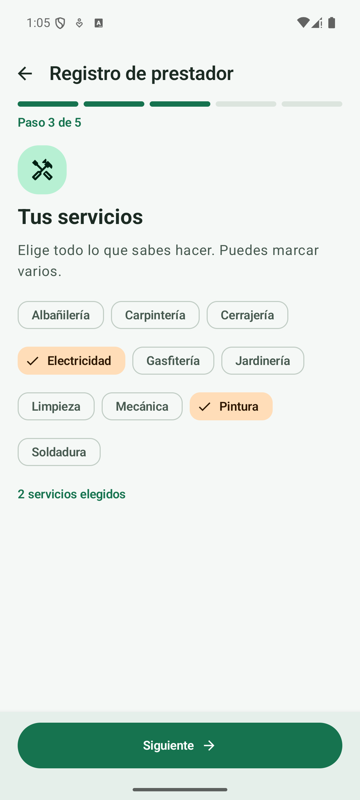

# Chamba PE — Android

App Android de Chamba PE para clientes y prestadores. Kotlin, Jetpack Compose y Material 3,
con un único módulo `app` y arquitectura MVVM.

> **Estado (26/11/2026):**
> - Compila y pasa 42 pruebas unitarias.
> - Los registros de cliente y de prestador se recorrieron paso a paso en un emulador (API 36) contra Django local, incluidos los errores de cada paso, el mapa, la revisión y el botón Atrás.
> - Las solicitudes ya van a la API, las mismas que ve la web.
> - Desde el 26/11 la app llama al Back End de usuario en **Spring Boot** (`backend/spring/`, puerto 8080), como
>   pide el diagrama de arquitectura. Spring responde igual que Django en las 13 rutas que usa la app (paridad
>   comprobada con `backend/spring/tools/paridad_solicitudes/correr.py`) y usa la misma base de datos.
>
> **Falta:**
> - Recorrer el alta y el ingreso con una cuenta real en el teléfono, con el `google-services.json` del proyecto del equipo (`chamba-pe-c043f`). En la computadora de Renzo hay uno de `chamba-pe-tecsup` (la app arranca con él); la cuenta de prueba la crea una persona del equipo.
> - Probar en un teléfono físico.

<p align="center">
  
  
  
  
</p>

## Qué hace

| Función | Cómo | Tema del curso de Móviles |
|---|---|---|
| Ingreso y registro de clientes en 3 pasos (nombre, correo, contraseña) | Firebase Authentication (correo y contraseña) | Semana 11 |
| Registro de prestador en 5 pasos: cuenta, datos, servicios, zona en el mapa (centro y radio) y revisión con «editar» | Firebase Auth + `POST /api/prestadores/registro-movil/` con el token; si Django lo rechaza, la cuenta se deshace y la app vuelve al paso del error | Semanas 9 y 11 |
| Roles cliente / prestador | `GET /api/usuarios/yo/` con el token de Firebase (la misma cuenta que ve la web); el rol decide las pestañas | Semanas 9 y 11 |
| Rubros y búsqueda de prestadores | Retrofit contra la API Django (`/api/prestadores/rubros/` y `/buscar/`) | Semanas 9 y 10 |
| Datos guardados y modo sin conexión | Room: última búsqueda por rubro y rubros | Semana 8 |
| Favoritos | Room; se conservan al cerrar la app y al volver a buscar | Semana 8 |
| Ubicación del cliente arriba, como una app de delivery: se **escribe la dirección** (calle y distrito, con sugerencias), se usa el GPS o se mueve el mapa bajo un alfiler; nunca se ven coordenadas | `Geocoder` del sistema (sin clave), limitado al Perú; hoja inferior de Material 3 | Semanas 11 y 12 |
| «Mi dirección» en Perfil: Buscar empieza con ella | `SharedPreferences`; se borra al cerrar sesión | Semana 8 |
| **Inicio** al estilo de una app de delivery: ubicación arriba, buscador que entiende «gasfitero» o «wifi», una **tarjeta grande por sección** (Urgente, Hogar, Residencial, Empresas) y «Lo más pedido». Cada tarjeta abre su sección en otra pantalla, con su color, sus rubros y los resultados; un rubro puede estar en varias secciones. Rubros con un ícono cada uno; resultados en **Lista** o **Mapa** (marcadores numerados con ficha y calificación) y círculo de cobertura en el registro de prestador | Íconos Material outlined; Google Maps con `maps-compose`; clave en `local.properties` | Semanas 11 y 12 |
| «Usar mi ubicación actual» | Permiso de ubicación aproximada + Fused Location; la calle sale del `Geocoder` | Semana 11 |
| «Recomendado para ti» (HU-10): el prestador que sugiere la IA, con el motivo y la llegada estimada, encima de los resultados; si falla, la lista se ve igual | `GET /api/ia/recomendacion/` (Spring), pública como la búsqueda | Semanas 9 y 10 |
| Enviar solicitud, seguir sus etapas (HU-11) y calificar (HU-12) | API Django `servicios` y `calificaciones` con el token; consulta cada 5 s, como la web | Semanas 9 y 11 |
| Bandeja del prestador: aceptar, rechazar, avanzar y llamar al cliente | API Django (la misma bandeja que la web) | Semanas 9 y 11 |
| Mi disponibilidad (Activo / Inactivo) del prestador | Retrofit a `/api/usuarios/disponibilidad/` con el token de Firebase; la búsqueda la refleja al instante | Semanas 9 y 11 |
| Aviso «Solicitud enviada» | Notificación local con canal y permiso `POST_NOTIFICATIONS` | Semana 12 |
| Navegación y pestañas por rol | Navigation Compose + `NavigationBar` | Semanas 5 y 6 |

**No incluye todavía:** notificaciones push con FCM, certificados ni verificación de DNI desde la app.

**Diseño:**
- Icono adaptable vectorial (pin con llave y radio de cobertura) con capa monocroma, y animación de apertura con SplashScreen:
  el pin cae, el radio se abre y la llave gira a su sitio en 740 ms (Android 12+; en 8 a 11, icono fijo).

  
- Tema Material 3 claro y oscuro con los colores de la web (`ui/Tema.kt`) e iconos Material.
- Asistente por pasos reutilizable (`ui/Asistente.kt`): progreso animado, transición de eje X y Back del sistema paso a paso.
- Microanimaciones breves con curvas de Material: presión de botones, favorito que late, línea de tiempo del servicio y listas con `animateItem`.

## Estructura

```text
app/src/main/java/pe/tecsup/chambape/
├── MainActivity.kt
├── ChambaPeApplication.kt     AppContainer: crea API, base de datos y repositorios
├── domain/model/              modelos que usa la interfaz (sin Retrofit, Room ni Firebase)
├── data/
│   ├── remote/                ApiService (Retrofit) y DTO
│   ├── local/                 entidades, DAO y base de datos Room
│   ├── mapper/                DTO -> entidad -> modelo
│   ├── auth/                  AuthRepository (interface) y FirebaseAuthRepository
│   └── repository/            PrestadorRepository y SolicitudRepository (interfaces + implementación)
├── device/                    ubicación y notificaciones (interfaces + implementación Android)
└── ui/                        pantallas Compose, ViewModel con UiState y navegación
```

Los ViewModel dependen de las interfaces, no de Retrofit ni de Firebase; por eso
`BusquedaViewModelTest` usa un repositorio falso.

## Requisitos

- JDK 17 o superior (probado con Temurin 25).
- Android SDK con la plataforma 37. Con Android Studio se instala solo; `local.properties`
  (no versionado) debe apuntar a él: `sdk.dir=C\:/Users/<usuario>/AppData/Local/Android/Sdk`.
- `app/google-services.json` del proyecto Firebase `chamba-pe-c043f` (no versionado). Se descarga
  desde la consola de Firebase: Configuración del proyecto → app Android `pe.tecsup.chambape`.
- Clave de Google Maps en `local.properties` (no versionado): `MAPS_API_KEY=...`, con «Maps SDK for Android»
  habilitado. Sin clave, el mapa aparece en gris.
- No hace falta instalar Gradle: se usa el wrapper (`gradlew`).

## Comandos

Desde `app-movil/`:

```bash
./gradlew assembleDebug        # compila el APK de depuración
./gradlew testDebugUnitTest    # pruebas unitarias
./gradlew lintDebug            # lint de Android
./gradlew installDebug         # instala en un emulador o dispositivo conectado
```

## Datos de prueba cerca de TECSUP (Santa Anita)

Para que la app tenga variedad al probar, con la base local de Django:

```powershell
$env:DJANGO_DEBUG="true"; python backend/django/manage.py sembrar_demo_santa_anita
```

Crea o actualiza 30 prestadores verificados a 0,3–4 km de TECSUP (Av. Cascanueces 2221), con nombres de
personas («Joel Rivas») y de marcas («ElecTools», «GasfiExpress»), rubros repetidos, varios con
calificaciones, y los 8 rubros que la app agrupa en sus secciones (Cámaras de seguridad, Aire
acondicionado, Fumigación…). Se puede correr varias veces; `--quitar` borra solo esos datos. Fuera de
desarrollo (`DJANGO_DEBUG` apagado) no hace nada. En la app, pon «Av. Cascanueces 2221, Santa Anita» como
«Mi dirección».

## Conectar con la API (Spring Boot)

La app llama por defecto a `http://127.0.0.1:8080/` con Spring corriendo en la PC (ver
[`backend/spring/README.md`](../backend/spring/README.md)).

- **Emulador:** no hace falta nada. La app detecta el emulador y usa `10.0.2.2`, la dirección con la que
  el emulador llega a la PC (antes dependía de `adb reverse`, que se pierde al reiniciar adb o el
  emulador y dejaba la app en «No hay conexión»).
- **Teléfono por USB:** redirige el puerto con `adb reverse tcp:8080 tcp:8080`. Spring usa la misma base de datos que Django, así que
lo que haga la app se ve en la web y en la administración. Para otra URL:
`./gradlew assembleDebug -Pchambape.apiBaseUrl=https://mi-servidor/` (por ejemplo `http://127.0.0.1:8000/`
para volver a Django, con `adb reverse tcp:8000 tcp:8000`). Solo se permite HTTP sin cifrar hacia
`127.0.0.1`, `localhost` y `10.0.2.2`.

## Firebase solo para la identidad; los datos en Spring Boot (y Django)

Como en el diagrama de arquitectura, la parte **Usuario** (esta app y la web de cliente y prestador)
habla con **Spring Boot**, y **Administración** con Django; los dos usan la misma base de datos.
Desde el 26/11 la app **no usa Firestore**: Firebase Authentication da la identidad (correo y
contraseña) y todo lo demás vive en la base compartida:

| Qué | Ruta (Spring, con las mismas respuestas que Django) |
|---|---|
| Rol y prestador de la cuenta | `GET /api/usuarios/yo/` (antes Firestore `usuarios/{uid}`) |
| Alta de cliente | `POST /api/usuarios/registro-movil/` al registrarse; si falla, la cuenta de Firebase se deshace |
| Alta de prestador | `POST /api/prestadores/registro-movil/`; queda vinculado y con su ID sin pasos manuales |
| Solicitudes, seguimiento y calificación | `servicios` y `calificaciones` (AND-23) |

Todas las rutas privadas reciben `Authorization: Bearer <token de Firebase>`. Spring y Django lo
aceptan si arrancan con `FIREBASE_AUTH_PROJECT_ID` igual al proyecto del `google-services.json`.

- Una cuenta de Firebase sin cuenta en la base (por ejemplo, creada antes del 26/11) se crea como
  **cliente** al entrar. Un prestador creado en la web necesita «UID de Firebase» en su perfil
  (`/admin/` de Django → Perfiles); ya no hace falta `prestadorId` en Firestore.
- Si la cuenta está suspendida o bloqueada (HU-13), la API responde 403 con `codigo:
  "cuenta_sancionada"` y la app no entra (ni sigue dentro al reabrirla); sin vincular, `codigo:
  "cuenta_no_vinculada"`.
- El último perfil conocido se guarda en el teléfono: sin red, la app abre con el rol correcto.
- Detalle del token en [`docs/API_AUTENTICACION.md`](../docs/API_AUTENTICACION.md).

### Proyecto de Firebase

- Proyecto del equipo: `chamba-pe-c043f` (confirmado por Luis el 26/11). El `google-services.json` de
  `app/` (no se versiona) y `FIREBASE_AUTH_PROJECT_ID` de Spring y Django **tienen que ser del mismo
  proyecto**; si no, Django y Spring rechazan el token con 403.
- `chamba-pe-tecsup` (cuenta de Renzo) tiene la misma app Android registrada con las huellas SHA-1 y
  SHA-256 de depuración; sirve mientras no haya acceso a `c043f` (el 26/11 la cuenta de Renzo no lo tenía).
- Authentication por correo y contraseña activo. Firestore ya no lo usa la app: sus reglas
  ([`firestore.rules`](firestore.rules)) siguen limitando cada documento a su dueño y se pueden cerrar
  (`allow read, write: if false;`) cuando nadie use una versión anterior al 26/11.

## Versiones

Todas en [`gradle/libs.versions.toml`](gradle/libs.versions.toml); ese archivo lo comparten todas
las tareas `AND-*` y sus cambios se coordinan con el equipo.

| Elemento | Valor |
|---|---|
| Gradle (wrapper) / AGP | 9.9.1 / 9.5.1 (AGP incluye Kotlin; no se aplica `kotlin-android`) |
| Plugin de Compose / KSP | 2.4.21 / 2.3.14 |
| Compose BOM / Firebase BOM | 2026.09.00 / 35.2.0 |
| Room / Retrofit / Navigation | 2.8.5 / 3.0.0 / 2.10.2 |
| maps-compose / íconos Material | 8.4.0 / 1.7.8 (extendidos) |
| `compileSdk` / `targetSdk` / `minSdk` | 37 / 37 / 26 |
| Paquete | `pe.tecsup.chambape` |

## Qué no va en el repositorio

`local.properties`, `google-services.json`, almacenes de firmas (`*.jks`, `*.keystore`) y
`keystore.properties` están en `.gitignore`. No se incrustan URL de producción ni credenciales.
